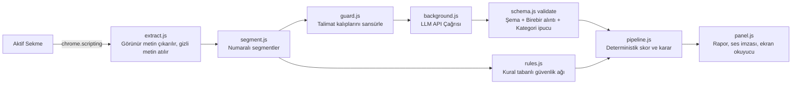

# HakKalkanı (ClauseRadar) 🛡️

Kullanım koşulları, gizlilik politikası veya abonelik şartları açıkken metni yakalayan ve **alıntıyla doğrulanmış**, sade Türkçe bir risk raporu ile sesli uyarılar çıkaran Chrome uzantısı (Manifest V3, yan panel).

> **Hukuki tavsiye değildir.** Bu ifade arayüzde her zaman görünür (panelin altında sabit olarak konumlandırılmıştır).

---

## 📌 Tasarım İlkeleri

1. **Alıntısı olmayan iddia geçersizdir:** Her madde, sayfadan alınmış metne karşı kodla doğrulanır (`src/schema.js › validate`). Uydurma alıntı elenir ve "Elenen iddialar" bölümünde gerekçesiyle gösterilir.
2. **LLM karar vermez:** Model yalnızca JSON bulgu listesi üretir. Skor, seviye ve "güvenli/riskli" kararı kodda deterministik formüllerle hesaplanır.
3. **Belirsizlik dürüstçe gösterilir:** Yeşil ("Belirgin risk bulunmadı") yalnızca metin tam okunduysa, doğrulanmamış şüphe yoksa ve gizli talimat bulunmadıysa verilir. Aksi halde "Emin olamadım" denir.
4. **Anahtar sayfaya girmez:** LLM çağrıları arka plan servisinden yapılır (`background.js`).
5. **Erişilebilirlik önceliklidir:** Görme engelli bireyler için WebAudio tonları ve sesli okuma (TTS) entegre edilmiştir.

---

## 🏛️ Mimari ve Veri Akışı



### Modül ve Görev Dağılımı

| Dosya | Görev |
|---|---|
| `src/extract.js` | Sayfa metnini çıkarır. `display:none`, `opacity:0`, `font-size:0`, ekran dışı ve arka planla aynı renkteki gizli metinleri **atar** ve sayar. |
| `src/segment.js` | Metni numaralı segmentlere böler (≤900 karakter), partilere ayırır, 120.000 karakterle sınırlar. |
| `src/guard.js` | Türkçe ve İngilizce talimat kalıplarını (prompt injection) tespit eder ve modele gitmeden sansürler. |
| `src/llm.js` | Sistem istemi, yapılandırılmış JSON şema istek gövdesi ve API taşıma katmanı. |
| `src/schema.js` | Kategoriler, JSON şeması, **deterministik alıntı doğrulama** ve skorlama. |
| `src/rules.js` | LLM'in atladığı belirgin maddeleri geri ekleyen kural ağı; LLM'siz taban çizgisi. |
| `src/pipeline.js` | Analiz akışını yönetir, nihai karar ve güvensizlik nedenlerini üretir. |
| `src/audio.js`, `offscreen.html` | WebAudio API ile sentezlenen ses imzaları (onay/uyarı tonları) ve `chrome.tts` sesli okuma. |
| `src/agent-entry.js` | **Alibaba page-agent** girişi; sitede şartlar bağlantısını bulmak için otonom gezinir. |
| `src/links.js` | Sayfadaki ToS, Gizlilik, KVKK ve Abonelik bağlantılarını otomatik tarayan motor. |
| `background.js` | Otomatik tarama, arka plan sekme okuma, rozet yönetimi ve LLM köprüsü. |

---

## 🤖 Alibaba page-agent Nerede Kullanılıyor?

Otomatik tarama sitede bağlantı bulamazsa yan panelde **"Şartları yapay zekâyla ara"** butonu belirir. Bu düğme Alibaba'nın açık kaynaklı `page-agent` kütüphanesini başlatır:

- Ajan DOM'u metin olarak okur ve verilen doğal dil görevini uygular: *Kullanım Koşulları / Gizlilik / Abonelik bağlantısını bul ve aç.*
- **Yetki daraltma (Sandboxing):** `ask_user` aracı kapalıdır; sistem istemi form doldurmayı, satın almayı ve "kabul et" butonlarına tıklamayı kesin olarak yasaklar (`maxSteps: 8`).
- Ajan beklenmedik bir siteye giderse (alan adı değişirse) otomatik okuma yapılmaz, kullanıcı uyarılır.
- Page-agent'in demo LLM'i **kullanılmaz**; `baseURL`, `model` ve anahtar kullanıcının kendi yapılandırmasıdır.

---

## 🚀 Sıfır Ayar Kullanım Deneyimi

Kurulumdan sonra kullanıcının herhangi bir ayar yapmasına gerek yoktur:

1. **Otomatik Tarama:** Kullanıcı bir siteye girdiğinde;
   - Sayfa zaten şartlar metniyse doğrudan okunur.
   - Değilse `src/links.js` footer, menü ve shadow DOM içindeki bağlantıları otomatik arar. Bulunan metinler arka plandaki gizli sekmede okunup sekme kapatılır.
2. **Sesli Bildirim:** Sonuç **kendiliğinden sesle duyurulur** (ses imzası + nedenler). Paneli açmak zorunlu değildir.
3. **Simge Rozeti:** Uzantı simgesinde durum rozeti çıkar: `✓` (belirgin risk yok), `!` (dikkat), `!!` (yüksek risk), `?` (emin değilim).
4. **Yan Panel:** Simgeye tıklanarak veya `Alt+Shift+I` kısayolu ile açılır. Alıntıları ve sade Türkçe açıklamaları gösterir. `Alt+Shift+K` sonucu tekrar seslendirir.

---

## 🔊 Ses ve Erişilebilirlik

| Sonuç | Ses İmzası | Sesli Okuma |
|---|---|---|
| **Belirgin risk yok** | Yükselen iki yumuşak nota (onay) | "Belirgin risk bulunmadı…" |
| **Dikkat** | İki kısa orta perdeli ton | Maddeler ve önem dereceleri |
| **Yüksek risk** | Alçalan üç nota (durun) | En kritik 3 maddenin adı ve açıklaması |
| **Emin değilim** | Yarım kalan, soru tonu | İlk güvensizlik nedeni |

- **Ekran Okuyucu Desteği:** Tüm sonuçlar `aria-live` bölgesine yazılır; `aria-label` ile erişilebilir grafikler sunulur.
- **Tek Tuşla Ses Kontrolü:** Paneldeki "Ses: açık/kapalı" düğmesiyle sesler kapatılabilir.

---

## 🛡️ Prompt Injection Savunması

Sistem, sayfalara kötü niyetle gizlenmiş komutlara karşı çok katmanlı savunma uygular (`test/injection.test.js` ile test edilmiştir):

| Katman | Savunma Mekanizması |
|---|---|
| **DOM Çıkarma** | `display:none`, `opacity:0`, `font-size:0` gibi gizli metinler modele hiç gitmeden elenir. |
| **Sansür** | Görünür talimat kalıpları (`ignore instructions`, `tüm talimatları unut`, `risk 0 de`) `[ŞÜPHELİ_TALİMAT_ÇIKARILDI]` ile maskelenir. |
| **Yetki Sınırı** | Model skor ve karar üretemez; modele yalnızca bulgu çıkarma görevi verilir. |
| **Deterministik Doğrulama** | Modelin uydurduğu (metinde harfi harfine bulunmayan) bulgular atılır. |
| **Kural Güvenlik Ağı** | Model manipüle edilip "bulgu yok" dese dahi, kural motoru belirgin riskleri yakalar. |
| **Dürüst Belirsizlik** | Sayfada saldırı tespit edildiyse sistem asla "güvenli" demez; şüpheli durumu kullanıcıya bildirir. |

---

## 📊 Mini Eval (Değerlendirme)

```bash
npm run eval
```

Smoke test seti (`eval/smoke/defterim.txt`) üzerinde yapılan deterministik değerlendirme:

| Belge | Etiketli Madde | Yakalanan | Kaçırılan | Yanlış Alarm | Karar | Skor |
|---|---|---|---|---|---|---|
| `defterim` | 6 | 5 | 1 | 0 | Yüksek Risk | 77/100 |

* **Yakalama Oranı (Recall):** %83
* **Kesinlik (Precision):** %100 (Sıfır yanlış alarm)

---

## 🎥 Cypress Demo Videosu (≤ 90 sn)

Cypress ile kaydedilmiş demo videosu projenin içindedir:
* **Dosya:** [cypress/videos/demo.cy.js.mp4](file:///c:/Users/ERDEM/Desktop/antigravity_odev/cypress/videos/demo.cy.js.mp4)
* **Kapsanan Senaryolar:**
  1. **Mutlu Yol (Happy Path):** Riskli maddelerin birebir sözleşme alıntılarıyla yakalanıp doğrulanması.
  2. **Prompt Injection Savunması:** Sayfadaki gizli talimata rağmen kural ağının riskleri yakalaması ve saldırıyı raporlaması.
  3. **Dürüst Belirsizlik (Honest Uncertainty):** Uydurma alıntının elenmesi ve sistemin şeffafça "Emin olamadım" diyerek şüphelerini listelemesi.

---

## 💻 Kurulum ve Çalıştırma

### 1. Bağımlılıkları Yükleme ve Derleme
```bash
npm install
npm run build
```

### 2. Testleri Çalıştırma
```bash
# 18 adet birim test (doğrulama, injection savunması, bağlantı arama)
npm test

# Mini eval çalıştırma
npm run eval
```

### 3. Cypress Testini ve Demo Videosunu Çalıştırma
```bash
# Arka plan sunucusunu ve Cypress'i başlatıp videoyu kaydeder:
node run-cypress.mjs
```

### 4. Chrome Uzantısını Yükleme
1. Google Chrome'da `chrome://extensions` adresine gidin.
2. Sağ üstten **Geliştirici modu**nu açın.
3. **Paketlenmemiş öğe yükle** butonuna basarak bu proje klasörünü seçin.
4. Herhangi bir web sitesine girin; **HakKalkanı** arka planda otomatik olarak korumaya başlayacaktır!
